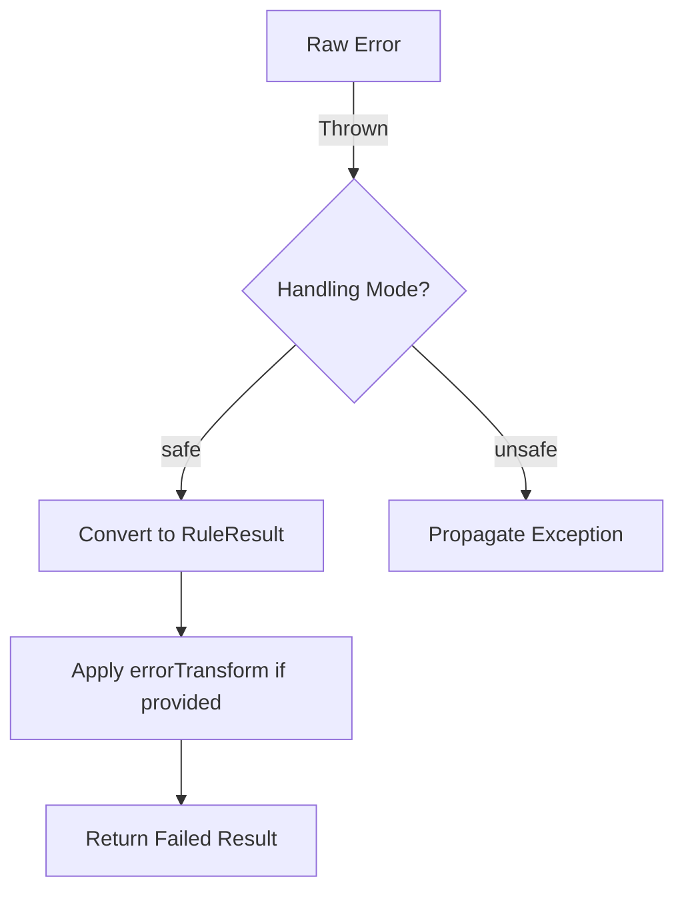
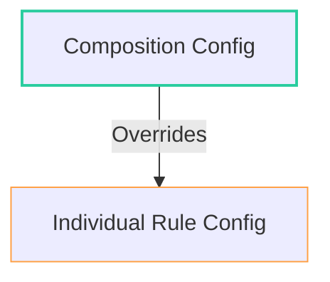
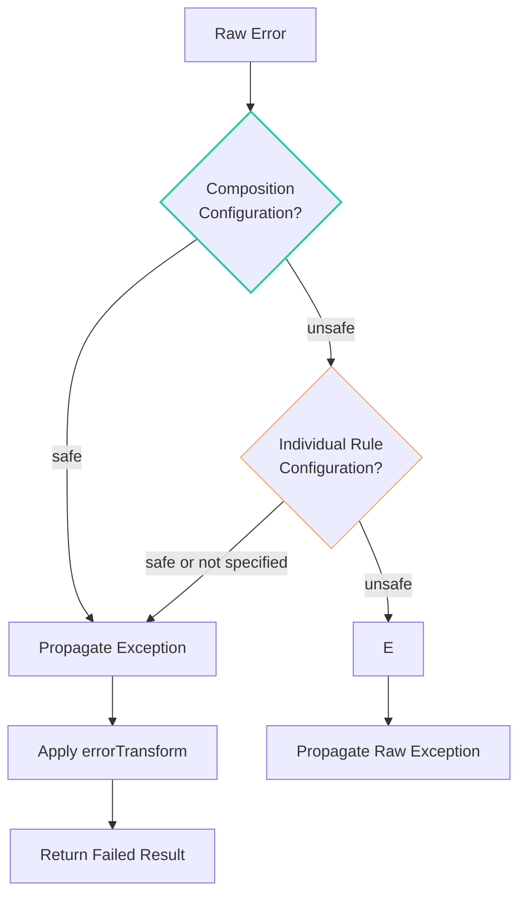

# TS Rules Composer

[](https://npmjs.com/package/ts-rules-composer)
[](https://bundlephobia.com/package/ts-rules-composer)
[](LICENSE)

A **dependency-free**, type-safe engine for composing business rules and policy checks into pipelines.

## Why

Schema validators answer "is this data shaped correctly?". Business rules ask more: does this user have permission, is this order within their limit, did the fraud service say yes before the timeout? Those checks need shared context, async calls, branching, retries and timeouts.

`ts-rules-composer` treats each check as a small function (a **rule**) and gives you combinators to wire rules together, with the input, context and error types inferred end to end. It complements schema validators such as `zod`; it does not replace them.

## Contents

- [Installation](#installation)
- [Quick start](#quick-start)
- [Features](#features)
- [Core concepts](#core-concepts)
- [Usage examples](#usage-examples)
- [Error handling](#error-handling-standardization)
- [Guardrails and policy checks](#guardrails-and-policy-checks)
- [Context cloning](#context-cloning-options)
- [Best practices](#best-practices)
- [Comparison to other libraries](#comparison-to-other-libraries)
- [API reference](#api-reference)
- [Cheat sheet](#cheat-sheet)
- [Contributing](#contributing)

## Installation

```bash
npm install ts-rules-composer
# or
yarn add ts-rules-composer
# or
pnpm add ts-rules-composer
```

Requires Node.js 22 or later, or a modern browser.

## Quick start

```typescript
import { fail, match, pass, pipeRules } from "ts-rules-composer";

type Order = { items: number; total: number; payment: "card" | "paypal" };
type Ctx = { limit: number };

// A rule is a function: (input, context?) => pass() | fail(error)
const hasItems = (order: Order) =>
  order.items > 0 ? pass() : fail("Cart is empty");

const withinLimit = (order: Order, ctx?: Ctx) =>
  order.total <= (ctx?.limit ?? 1000) ? pass() : fail("Over the spending limit");

const validateCard = (order: Order) =>
  order.total > 0 ? pass() : fail("Invalid amount");
const validatePaypal = (_order: Order) => pass();

// Combinators wire rules together; context reaches every rule
const validateCheckout = pipeRules<Order, string, Ctx>([
  hasItems,
  withinLimit,
  match((order: Order) => order.payment, {
    card: validateCard,
    paypal: validatePaypal,
  }),
]);

await validateCheckout({ items: 2, total: 40, payment: "card" }, { limit: 500 });
// → { status: "passed" }

await validateCheckout({ items: 0, total: 40, payment: "card" });
// → { status: "failed", error: "Cart is empty" }

await validateCheckout({ items: 1, total: 900, payment: "paypal" }, { limit: 500 });
// → { status: "failed", error: "Over the spending limit" }
```

`pipeRules` runs rules in order and stops at the first failure. See [Core concepts](#core-concepts) for the model and the [API reference](#api-reference) for every combinator.

## Features

- **Composable**: build pipelines from combinators such as `when`, `unless`, `match`, `every` and `mapError`
- **Zero dependencies**: small and tree-shakeable (`sideEffects: false`)
- **TypeScript first**: inference for inputs, contexts and errors
- **Async ready**: mix sync and async rules
- **Context-aware**: share state, services and configuration across rules
- **Resilient**: retries, timeouts, memoization and fallbacks built in
- **Extensible**: write your own combinators with the same `Rule` type
- **Instrumented**: `withDebug` and `withTap` for logging and metrics
- **Portable**: Node.js 22+ and modern browsers

## Core Concepts

### The Rule

At the heart of `ts-rules-composer` lies the **Rule** — a function that performs a single validation step.

Rules are:

- **Minimal**: they validate one thing only.
- **Composable**: they can be combined using higher-order combinators.
- **Pure** (ideally): they take an input and return a result, without mutating external state.
- **Async-compatible**: all rules can be sync or async, and combinators handle both transparently.
- **Context-aware**: optional `context` can be passed to any rule for dependency injection, configuration, or shared state.

#### Rule signature

```ts
type Rule<TInput, TError = string, TContext = unknown> =
  (input: TInput, context?: TContext) => Promise<RuleResult<TError>> | RuleResult<TError>;
```

- `TInput` – the type of input the rule receives
- `TError` – the type of error returned on failure (defaults to `string`)
- `TContext` – optional shared context object passed to the rule
- `Result` – your rule can return synchronously or asynchronously

#### Rule result

Rules must return one of two outcomes:

```ts
type RuleResult<TError = string> =
  | { status: "passed" }
  | { status: "failed"; error: TError };
```

Aggregating combinators change the error type: `every` and `oneOf` return a rule whose error is `TError[]` (one entry per failed rule), while `pipeRules`, `composeRules` and the rest keep a single `TError`.

Use the utility functions `pass()` and `fail(error)` to return results:

```ts
import { pass, fail } from 'ts-rules-composer';

const isEven = (n: number) =>
  n % 2 === 0 ? pass() : fail("Must be even");
```

#### Context example

Context is optional but powerful. It lets rules access external services, user configuration, or metadata.

```ts
type Ctx = { threshold: number };

const isAboveThreshold = (n: number, ctx?: Ctx) =>
  n > (ctx?.threshold ?? 0) ? pass() : fail("Below threshold");
```

When composing rules, context will be passed automatically to all child rules.

#### Composing rules

Rules are designed to be combined using **combinators** like `pipeRules`, `every`, `oneOf`, `when`, and `match`.

```ts
import { pipeRules } from 'ts-rules-composer';

const validate = pipeRules([
  isEven,
  isAboveThreshold
]);

const result = await validate(4, { threshold: 2 });
// → { status: "passed" }

const result2 = await validate(3, { threshold: 2 });
// → { status: "failed", error: "Must be even" }
```

---

Each rule is a **unit of validation** that plugs into powerful composition pipelines. You write simple rules and then combine them into expressive, testable flows using composable logic.

## Usage Examples

Complete, type-checked examples (they are compiled by `npm run typecheck`):

- [User Registration](./examples/user-registration.example.ts)
- [Financial Transaction Validation](./examples/financial-transaction.example.ts)
- [Model Deployment Validator](./examples/model-deployment.example.ts)

### Sketch: financial transaction pipeline

A sketch of how the combinators compose. Helper rules and services (`fraudService`, `validateCardNumber`, `bankAuthCheck` and so on) are assumed; see the linked file above for the runnable version.

```typescript
import {
  pipeRules,
  match,
  withRetry,
  withMemoize,
  withTimeout,
  when
} from 'ts-rules-composer';

// 1. Basic validators
const validateAmount = (tx: Transaction) =>
  tx.amount > 0 ? pass() : fail("Amount must be positive");

const validateCurrency = (tx: Transaction) =>
  SUPPORTED_CURRENCIES.includes(tx.currency)
    ? pass()
    : fail(`Unsupported currency: ${tx.currency}`);

// 2. Memoized fraud check (cached for 5 minutes)
const checkFraudRisk = withMemoize(
  async (tx: Transaction) => {
    const risk = await fraudService.assess(tx);
    return risk.score < 5 ? pass() : fail("High fraud risk");
  },
  tx => JSON.stringify([tx.userId, tx.amount, tx.recipient]),
  { ttl: 300000 }
);

// 3. Payment method handling
const validatePaymentMethod = match(
  tx => tx.paymentType,
  {
    "credit_card": pipeRules([
      validateCardNumber,
      validateExpiry,
      withTimeout(bankAuthCheck, 3000, "Bank auth timeout")
    ]),
    "crypto": validateWalletAddress,
    "bank_transfer": validateIBAN
  }
);

// 4. Complete pipeline
const validateTransaction = pipeRules([
  validateAmount,
  validateCurrency,
  
  // Only run fraud check for transactions > $1000
  when(
    tx => tx.amount > 1000,
    withRetry(checkFraudRisk, { attempts: 2 })
  ),
  
  validatePaymentMethod,
  
  // Compliance check (different for business/personal)
  match(
    tx => tx.accountType,
    {
      "business": validateBusinessTransfer,
      "personal": validatePersonalTransfer
    }
  )
]);

// Usage
const result = await validateTransaction(paymentRequest);
```

## Error Handling Standardization

This library provides consistent error handling across all validation operations through a standardized system:

### Core Principles

1. **No Uncaught Exceptions** - All errors are converted to `RuleResult` objects
2. **Type Safety** - Custom error types are preserved throughout operations
3. **Flexible Control** - Choose between safety and performance with error handling modes

### Standardization Functions

| Function                | Purpose                                                                 |
|-------------------------|-------------------------------------------------------------------------|
| `withSafeError`         | Wraps rules to catch exceptions and convert to failed validation results|
| `withSafePredicate`     | Safely handles predicate functions that may throw                       |
| `getNormalizedRule`     | Applies consistent error handling to single rules                       |
| `getNormalizedRules`    | Batch processes multiple rules with standardized error handling         |

### Error Handling Modes

Configure via `RuleSafetyOptions`:

```typescript
{
  errorHandlingMode?: 'safe' | 'unsafe',  // Default: 'safe'
  errorTransform?: (error: unknown) => TError // Custom error conversion
}
```

**Modes**:

- `safe`: (Default) All errors are caught and converted to validation failures
- `unsafe`: Lets exceptions propagate (for performance-critical paths). `errorTransform` has no effect in this mode, so passing both is a compile error.

### Error Flow



### Error Handling Recipes

1. **For validation logic**:

   ```typescript
   // Safe mode with custom error transformation
   const rule = getNormalizedRule(myRule, {
     errorTransform: (e) => ({ code: 500, message: String(e) })
   });
   ```

2. **For performance-critical paths**:

   ```typescript
   // Unsafe mode - ensure calling code handles exceptions
   const fastRule = getNormalizedRule(highPerfRule, {
     errorHandlingMode: 'unsafe'
   });
   ```

3. **Custom error types**:

   ```typescript
   type APIError = { status: number };
   const apiRule: Rule<string, APIError> = /*...*/;
   // Preserves APIError type through all transformations
   ```

### Debugging Tips

Enable debug mode to get enhanced error information:

```typescript
import { withDebug } from 'ts-rules-composer';

const debugRule = withDebug(myRule, {
  onError: (error) => console.error('Rule failed:', error)
});
```

### Error Handling Precedence Rules

**Key Principle**: Composition configuration always overrides individual rule settings. This ensures consistent behavior within each composition block.



#### Hierarchy of Control

1. **Composition-Level Setting** (Highest priority)
   - `pipeRules/composeRules/every/oneOf` configurations
2. **Rule-Level Configuration** (Only applies if composition allows)
   - `getNormalizedRule` settings
3. **Global Default** (`safe` mode)

#### Behavior Matrix

| Composition Mode | Rule Mode       | Effective Behavior       |
|------------------|-----------------|--------------------------|
| `safe`           | Any             | All rules run in safe mode |
| `unsafe`         | Not specified   | Rule's native behavior    |
| `unsafe`         | `safe`          | Rule runs in safe mode    |
| `unsafe`         | `unsafe`        | Rule runs in unsafe mode  |

#### Complete Error Flow



#### Examples

**1. Composition Forces Safe Mode** (Overrides all rules)

```typescript
// All rules will use safe mode regardless of their own config
const pipeline = pipeRules([
  unsafeRule,                // Will be forced to safe mode
  getNormalizedRule(rule, {  // Configuration ignored
    errorHandlingMode: 'unsafe' 
  })
], {
  errorHandlingMode: 'safe'  // ← Takes precedence
})
```

**2. Unsafe Composition with Mixed Rules**

```typescript
// Rules can specify their own mode since composition allows it
const pipeline = pipeRules([
  unsafeRule,                // Runs in unsafe mode
  getNormalizedRule(rule, {  // Runs in safe mode
    errorHandlingMode: 'safe' 
  })
], {
  errorHandlingMode: 'unsafe' // ← Allows rule-level configs
})
```

## Guardrails and policy checks

When a rule decides whether something is allowed (a permission check, a safety policy, an LLM or fraud judge), a wrong "pass" costs more than a wrong "fail". These defaults and habits keep the failure side safe.

- **Fail closed on errors.** In the default `safe` mode a thrown exception becomes a failed result, so a crashing check never passes. Do not use `errorHandlingMode: "unsafe"` on policy rules unless the caller handles exceptions. See [Error handling modes](#error-handling-modes).
- **Never retry a decision.** `withRetry` retries failed results by default, so a "no" can be retried into a "yes". For policy checks use `retryOn: "thrown"`, which retries only transient exceptions. See [`withRetry`](#withretryrule-options).
- **Keep the reason when retries run out.** `onExhausted: "last-error"` returns the final error instead of `"MAX_RETRIES_EXCEEDED"`.
- **Key caches by identity.** `withMemoize` shares entries between callers with the same key, so include everything the verdict depends on (user, tenant, input id), build keys with `JSON.stringify([...])` rather than joining strings, and key by context when the result depends on who is asking. See [`withMemoize`](#withmemoizerule-keyfn-options).
- **Time out as a failure.** `withTimeout` returns your `timeoutError` as a failed result, so a slow dependency blocks the action instead of letting it through.
- **Test the failure paths.** Assert that thrown errors, timeouts and exhausted retries all produce `status: "failed"`.

## Context Cloning Options

The library provides flexible context cloning strategies to balance between performance and correctness. You can control cloning behavior through `CompositionOptions`:

When `cloneContext` is enabled, the Context is cloned once for each composed Rule
invocation. That clone is shared by all child Rules in that invocation, so changes
made by one child Rule are visible to the others; the original Context is left
unchanged.

```typescript
type CompositionOptions = {
  cloneContext?: boolean;      // Enable/disable cloning
  cloneStrategy?: "shallow" | "json" | "structured"; // Defaults to "json"
} & RuleSafetyOptions;         // errorHandlingMode, errorTransform (see Error Handling)
```

### Cloning Strategies

The clone method is chosen by `cloneStrategy`. Without it, the JSON clone is used (it is never auto-upgraded to `structuredClone`):

| `cloneStrategy`   | Speed  | Depth | Special Types* | Circular Refs | Node.js | Browser |
|-------------------|--------|-------|----------------|---------------|---------|---------|
| `"shallow"`       | 🚀 Fast | Shallow | ❌ No         | ✅ Yes        | ✅      | ✅      |
| `"structured"`    | 🐢 Slow | Deep  | ✅ Yes         | ✅ Yes        | ✅      | Modern  |
| `"json"` (default) | 🏎 Fast | Deep  | ❌ No          | ❌ No         | ✅      | ✅      |

*Special Types: Date, Map, Set, RegExp, etc.

### Cloning examples

**1. Default Behavior (JSON clone)**

```typescript
// Uses the JSON clone
pipeRules(rules, { cloneContext: true })
```

**2. Force Shallow Clone**

```typescript
// Fastest option - only clones top-level properties
pipeRules(rules, { cloneContext: true, cloneStrategy: "shallow" })
```

**3. Force Structured Clone**

```typescript
// Most accurate - preserves special object types
pipeRules(rules, { cloneContext: true, cloneStrategy: "structured" })
// Falls back to the JSON clone if structuredClone isn't available
```

## Best Practices

1. **Small Rules** - Keep each rule focused
2. **Pure Functions** - Avoid side effects in rules
3. **Memoize** - Cache expensive validations
4. **Type Narrowing** - Use `requireContextRule` for safety
5. **Instrument** - Add metrics in production

## Comparison to Other Libraries

While many libraries focus on schema validation or static rules, `ts-rules-composer` is designed specifically for **composable business logic**, dynamic workflows, and contextual validation pipelines.

Here’s how it compares to popular alternatives:

| Library                                                                  | Type                    | Async | Context-Aware | Type Inference | Size (gzipped)          | Notes                                            |
| ------------------------------------------------------------------------ | ----------------------- | ----- | ------------- | -------------- | ------------- | ------------------------------------------------ |
| **`ts-rules-composer`**                                                  | Rule engine, functional | ✅     | ✅             | ✅              | \~2.3KB  | Built for composing complex, contextual rules    |
| [`zod`](https://github.com/colinhacks/zod)                               | Schema validation       | ✅     | ❌             | ✅              | \~40KB        | Excellent for static object validation           |
| [`io-ts`](https://github.com/gcanti/io-ts)                               | Runtime type validation | ✅     | ❌             | ✅              | \~5KB+       | Powerful but requires deep functional patterns   |
| [`json-rules-engine`](https://github.com/CacheControl/json-rules-engine) | Declarative JSON rules  | ✅     | ❌             | ❌              | \~25KB        | Config-based rules, limited type safety          |
| [`casl`](https://casl.js.org/)                                           | Authorization DSL       | ✅     | ✅             | ⚠️ Limited     | \~6KB         | Great for access control, not general validation |

---

### When to use `ts-rules-composer`

Choose `ts-rules-composer` when your validation or rule logic:

- Involves **multiple branching paths**, retries, timeouts, or side effects
- Requires **shared context** (e.g. user metadata, database, external services)
- Needs **clean separation** of rule logic and pipeline composition
- Must run in both **Node.js or the browser**
- Should remain **type-safe** and **composable**

This library is not meant to replace schema validators like `zod`, but to complement them — it's ideal when your business logic **cannot be expressed declaratively** or **requires orchestration** of multiple validation steps.

## API Reference

### Core Functions

#### `pipeRules(rules, options?)`  

Sequentially executes rules left-to-right (fails fast)  

```typescript
const validateUser = pipeRules([
  validateEmailFormat,
  checkEmailUnique,
  validatePassword
], { cloneContext: true })
```

#### `composeRules(rules, options?)`  

Sequentially executes rules right-to-left (fails fast)  

```typescript
const processInput = composeRules([
  normalizeData,
  validateInput,
  sanitizeInput
])
```

#### `every(rules, options?)`  

Runs rules in parallel (collects all errors)  

```typescript
const validateProfile = every([
  validateAvatar,
  validateBio,
  validateLinks
])
```

### Control Flow

#### `match(accessor, cases, defaultCase?, options?)`  

Pattern matching routing

```typescript
const validatePayment = match(
  order => order.payment.type,
  {
    credit: validateCreditCard,
    paypal: validatePaypal,
    crypto: validateCrypto
  },
  fail("Unsupported payment method")
)
```

#### `when(condition, rule, options?)`  

Executes only if condition is true  

```typescript
const validateAdmin = when(
  user => user.role === "admin",
  checkAdminPrivileges
)
```

#### `unless(condition, rule, options?)`  

Executes only if condition is false  

```typescript
const validateGuest = unless(
  user => user.isVerified,
  requireVerification
)
```

#### `ifElse(condition, ifRule, elseRule?, options?)`  

Branch between two rules  

```typescript
const validateAge = ifElse(
  user => user.age >= 18,
  validateAdult,
  validateMinor
)
```

#### `oneOf(rules, options?)`  

Tries rules until one passes  

```typescript
const validateContact = oneOf(
  validateEmail,
  validatePhone,
  validateUsername
)
```

#### `withFallback(mainRule, fallbackRule, options?)`  

Fallback when main rule fails  

```typescript
const validateWithFallback = withFallback(
  primaryValidation,
  backupValidation
)
```

### Error Handling

#### `mapError(rule, transform)`  

Transforms error output  

```typescript
const friendlyErrors = mapError(
  validatePassword,
  err => `Security error: ${err}`
)
```

#### `not(rule, error, options?)`  

Inverts rule logic  

```typescript
const isNotBanned = not(
  checkBanStatus,
  "Account must be active"
)
```

#### `withSafeError(rule, errorTransform?)`  

Wraps a rule to catch errors and convert them to failed RuleResults

```typescript
const customSafeRule = withSafeError(riskyRule, e => ({
  code: 500,
  message: String(e)
}));
```

#### `withSafePredicate(rule, errorTransform?)`  

Wraps a predicate function with error handling and type safety

```typescript
const safePredicate = withSafePredicate(
  (input: string) => input.length > 5,
  (err) => `Predicate failed: ${String(err)}`
);
```

### Performance

#### `withMemoize(rule, keyFn, options?)`  

Caches rule results  

```typescript
const cachedCheck = withMemoize(
  dbUserLookup,
  user => user.id,
  { ttl: 30000, maxSize: 100 }
)
```

`keyFn` also receives the context. If the result depends on who is asking, key
by context too, or one caller can be served another caller's cached result.
Build the key unambiguously: `JSON.stringify([...])`, not values joined with a
separator, which can collide:

```typescript
const perUser = withMemoize(
  permissionRule,
  (input, context) => JSON.stringify([context?.userId, input.id])
)
```

#### `withTimeout(rule, ms, timeoutError, options?)`  

Adds execution timeout  

```typescript
const timeboundRule = withTimeout(
  apiCheck,
  3000,
  "Request timed out"
)
```

#### `withRetry(rule, options)`  

Automatic retries on failure  

```typescript
const resilientRule = withRetry(
  flakyServiceCheck,
  { attempts: 3, delayMs: 1000 }
)
```

By default both failed results and thrown exceptions are retried. A failed
result is a decision, not a transient fault: for policy checks and guardrails
use `retryOn: "thrown"` so a "no" is never retried into a "yes".

```typescript
const policy = withRetry(judgeRule, { attempts: 3, retryOn: "thrown" })
```

When every attempt fails the rule returns `"MAX_RETRIES_EXCEEDED"`, which hides
why it failed. Pass `onExhausted: "last-error"` to return the final error
unchanged; the error type then stays `TError`.

```typescript
const keepsReason = withRetry(flakyServiceCheck, {
  attempts: 3,
  onExhausted: "last-error"
})
```

### Context Management

#### `requireContextRule(error, rule, typeGuard?)`  

Enforces context requirements  

```typescript
const authRule = requireContextRule(
  "Authentication required",
  (input, ctx: AuthContext) => checkPermissions(ctx.token),
  (ctx): ctx is AuthContext => !!ctx?.token
)
```

#### `withLazyContext(loader, rule)`  

Lazy-loads context  

```typescript
const profileRule = withLazyContext(
  userId => fetchProfile(userId),
  validateProfile
)
```

#### `hasContext(ctx)`  

Type guard for context  

```typescript
if (hasContext<AuthContext>(context)) {
  // context is now typed as AuthContext
}
```

### Instrumentation

#### `withDebug(rule, options)`  

Adds debug logging  

```typescript
const debugRule = withDebug(validateOrder, {
  name: "OrderValidation",
  onEnd: (input, result) => console.log(result)
})
```

#### `tap(effect)`  

Creates a standalone tap effect for use in composition pipelines

```typescript
pipeRules([
  tap((input) => console.log('Processing: ', input)),
  validateInput
])
```

#### `withTap(effect, options?)`  

Wraps a rule with side effects without modifying its result

```typescript
const loggedRule = withTap((input, result) => {
  analytics.trackValidation(input, result)
})

const ruleResult = await loggedRule(input)
```

### Utilities

#### `pass()`  

Creates success result  

```typescript
const success = pass()
```

#### `fail(error)`  

Creates failure result  

```typescript
const failure = fail("Invalid input")
```

#### `validateField(getter, rule, defaultValue?)`  

Validates object fields  

```typescript
const validateEmail = validateField(
  user => user.email,
  validateEmailFormat
)
```

#### `inject(dependency, ruleFactory)`  

Dependency injection  

```typescript
const createDbRule = (db: Database) => (input: string) =>
  db.exists(input) ? pass() : fail("Not found")

const dbRule = inject(database, createDbRule)
```

## Cheat Sheet

### Core

| Function | Description | Example |
|----------|-------------|---------|
| `pipeRules` | Sequential validation left-right (fail-fast) | `pipeRules([checkA, checkB])` |
| `composeRules` | Sequential validation right-left (fail-fast) | `composeRules([checkA, checkB])` |
| `every` | Parallel validation (collect all errors) | `every([checkX, checkY])` |
| `match` | Pattern matching routing | `match(getUserType, { admin: ruleA, user: ruleB })` |
| `ifElse` | Conditional routing | `ifElse(isUnderAge, validateMinorAccount, validateAdultAccount)` |

### Combinators (summary)

| Combinator | Purpose | Example |
|------------|---------|---------|
| `when` | Conditional execution | `when(isAdmin, validateAdmin)` |
| `unless` | Negative condition | `unless(isGuest, validateAccount)` |
| `not` | Invert rule logic | `not(isBanned, "Must not be banned")` |
| `oneOf` | First-successful validation | `oneOf([validateV1, validateV2])` |
| `withFallback` | Fallback rule | `withFallback(primary, backup)` |

### Performance (summary)

| Utility | Use Case | Example |
|---------|----------|---------|
| `withMemoize` | Cache results | `withMemoize(expensiveCheck, input => input.id, { ttl: 30000 })` |
| `withTimeout` | Add time limit | `withTimeout(networkCall, 3000, "Timeout")` |
| `withRetry` | Automatic retries | `withRetry(unstableAPI, { attempts: 3 })` |

### Instrumentation (summary)

| Tool | Purpose | Example |
|------|---------|---------|
| `withDebug` | Debug logging | `withDebug(rule, { name: "Validation" })` |
| `tap` | Side effects | `tap((input, context) => log(input))` |

## Contributing

1. Fork the repository
2. Create a feature branch (`git checkout -b feat/amazing-feature`)
3. Commit changes (`git commit -m 'Add amazing feature'`)
4. Push to branch (`git push origin feat/amazing-feature`)
5. Open a Pull Request

## License

MIT © Breno Magalhães  
**Like this project?** ⭐️ [Star it on GitHub](https://github.com/Brenopms/ts-rules-composer)
